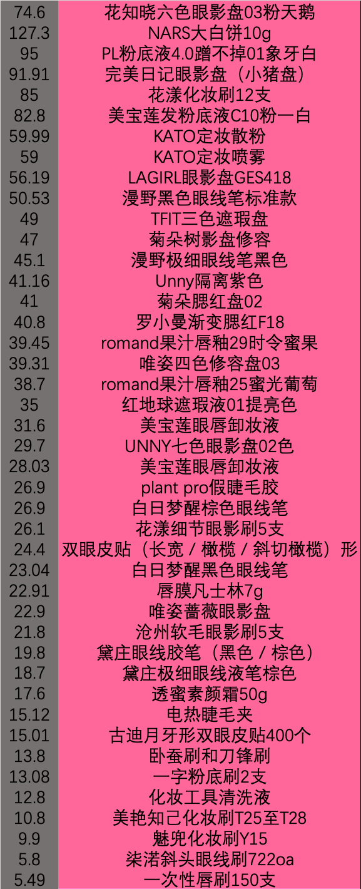
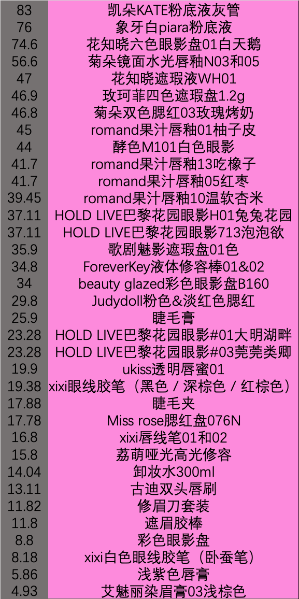

# Airi 的化妆教程

## 1. 前言

一个前大三小南梁的化妆杂谈篇（现在正在某粉红色的 B 工作喵）。

- 本篇讲一下化妆流水线。化妆非常类似于纸质绘画，只不过更加简单，流程更固定
- 为了让米那桑变得更可爱！这里整理一些一年多以来的经验
- 本篇无法涉及到真实物理世界的细节，主要是讲核心思想。
- 具体操作需要跟着妆教视频动手，大概20多次以后才能做到比较熟练，且能够实现较好的效果。
  - 笔者认为自己的最大进步是在第 22 次实现，即神乐七奈那一次
- 不过前期就算不熟练，也能很直观的感受到自己的进步

其实化妆品并不是很贵，不到 2000 块就可以买来能用一辈子的量。

> 如果你好奇我的背景的话，我在 2025-1-23 第一次实践女装，截至 2026-11-17 女装共计 29 次（全妆 cos）
>
> 做过 3 次只化妆不走完全流程的练习
>
> 在此期间，由于学习压力（不是考试那种学习）和就业压力，以及严重的性别焦虑（好吧直白点说就是笔者应该算是一个跨性别者，或至少有强烈的跨性别倾向，感觉之前因此都差点似了），上半年很多时间花在学习和去精神卫生中心了，实际平均下来能凑出精力来 cos 的频率实际上不是非常高，最近处境有所改善，可以说好了很多
>
> 以及因此，我或许可以提供一些关于女装的，一般人不会注意到的较深入见解

请注意，此教程希望让你看起来真的能像女孩子，或至少不像是*普通的*男孩子，而非整活、恶搞或不认真性质的女装。不仅是要像，还希望至少大部分人觉得你这样挺好看。即使你无法做到让人完全猜不出来是女孩子，也可以做到“好看”，一般这比前者更重要。

## 2. 关于性别的基础知识扫盲

关于男女的基础差异，你需要有个基本的了解。请你回答一个问题：是什么让你一眼看出来 Alice 是女孩子，而 Bob 是个男孩子？又是什么让你偶尔觉得判断 Catherine 的性别时犹豫了几秒钟？

首先存在如下决定性因素。以下因素比基本面部特征更快地使你完成判定：

- **体积差异**：Alice 的体积较小，Bob 较大，具体而言：
  - Alice 的身高较低，一般在 160-170，但 180 也可以，不是单一判定因素。
  - Alice 的胸廓（上半身从前后两面看的面积大小）更小，Bob 更大。
    - 这是强判定因素，像 Bob 一样大的女孩子一般都会是非常成熟丰满的熟女，或者非常肥胖的女孩。
    - 这也是为什么有的男孩子很矮，你却依然能看出来他不是女孩子
    - 这也是为什么，**男孩子可以留长发，但是和女孩子留长发实质上是不同的**。
  - Alice 的肩宽更低，一般36-37 左右，Bob 至少 40 往上
    - 这属于上一因素的一部分。
    - 如果你的肩宽在 40 或甚至以下（如 39），则你在此方面天赋较好，笔者本人即大约 40。
    - 警告：引体向上，卧推等上半身锻炼会导致肩宽增加，对女装来说极其危险。
  - Alice 的头颅体积整体小于 Bob
    - 这里暂不提及面部细节，你需要知道的是，仅仅是体积大小，就已经构成了强判定
  - Alice 的脖子显著比 Bob 更细
    - 这无法避免，笔者几乎从未见过像女孩子一样细脖子的男孩子
    - 不排除是笔者的特殊情况导致我对这类特征很敏感
  - Alice 的手掌比 Bob 小，不是很明显，也不是很不明显，取决于观察者敏感度
  - Alice 的腰，即使 Bob 和她一样身材健康，也会显著小于 Bob
    - 例如即使 Bob 已经很像女孩子，腰围 72，那么性转的 Bob 腰围大概对应的也在 68 或以下
    - 一般人不会直接注意到
- **脂肪分布**：Alice 的脂肪分布和 Bob 存在差异
  - Alice 的手比 Bob 丰满
    - 主要是手背，和小臂。Bob 可以看到明显的青筋。Alice 则没有，或弱一点。
    - 这是无法避免的。如果 Bob 要和 Alice 的手类似，那么他已经胖到了事实上不可能女装
  - Alice 的大小腿肌肉感很弱
    - Alice 的腿上几乎无法看到肌肉线条
    - Bob 则一眼可以看出肌肉轮廓
    - 注意，这不一定，如果你不做高强度锻炼，那么在适当的体重下，Bob 的腿可以比 Alice 更符合女孩子一般特征，也就是几乎看不出任何肌肉线条，看不到骨头形状（即不是骨瘦如柴），看起来苗条但软组织丰富，几乎是完美的腿
    - 因此笔者--**严格不建议**--为了女装以高强度跑步减肥。你应该从饮食和散步入手做这个。
  - 如果长胖，Bob 更倾向于肚子变大，而 Alice 更倾向于四肢和全身各处都肿大。
- **骨架趋势**：Alice 的骨架趋势和 Bob 不一致
  - 这里部分和体积那一条重合，因此部分方面不再提及，例如肩宽。剩下的只有少数几条
  - Alice 的胯宽显著大于 Bob，导致下半身到腰部的过渡呈现出一个明显的外扩弧，而不是一条直线
    - Bob 也一样会有这样的外扩弧，只是不明显，如果你能明显看出来，则天赋较好
    - 警告：高强度锻炼可能破坏此天赋
    - 这个还好。你穿一个丰胯裤可以显著改善。
  - Alice 的脚小于 Bob。骨头上比较小。
    - Alice 穿的鞋子至多不超过 39 码。Bob 的鞋子几乎至少不低于 40 码。
    - 如果你穿的鞋在 40 码左右，则你有天赋。笔者即大约 40 码。
    - 一般人可能不会注意到，只要你不要太极端的穿超大的鞋子，否则普通人还是能靠本能看出来的。
  - Alice 的膝盖骨节不发达，Bob 可以看出明显的膝盖凸起
    - 这几乎不影响现代审美，只要 Bob 凸起的不太极端
    - 一般人也不知道这是性别差异的一方面。
  - Alice 显然没有可见喉结，喉结属于软骨
    - 你不明显当然最好，明显了，如果其他地方好看，这也不会使你不好看

### 面部特征

目前就这么多吧，后续想到了会更新。这里先简单提一下面部特征；下面的化妆经验也有一些相关信息。主要区别：

- Alice 的面部竖直长度更低，所以建议你假发也剪或者约要求鬓角长一点的
- Alice 的面部更圆润。Bob 的脸如果看起来骨感强烈，对女装是很不利的
- Alice 的颧骨更不突出，更低，更不发达
- Alice 额头平直，不会出现向前突出，导致压眼睛。
  - 笔者还不理解的是，为什么见到的欧美女孩子明明像国内男孩子一样额头突出，但看起来还是像女孩子
- Alice 的眼睛绝对大小，几乎和 Bob 全无区别。只是脸比较小，显得眼睛大。
  - 如果你的眼睛较大，则显然是优势
- Alice 的下巴尖尖的，Bob 很可能会出现下巴有一小段直的。
  - 如果你天赋好，则没有或不明显。
  - 如果有，则对女装几乎是致命的。
- Alice 的下颌骨角度比较大，或者说，就是耳朵下面那个骨头比较高，比较不发达，看起来不是国字的方形脸，而是尖尖的鹅蛋脸。这不是说 Bob 就必然没 Alice 好，实际上完全可能倒挂，取决于天赋。
- Alice 的苹果肌，脸颊的肉更饱满。如果你小时候比较胖，大概率也不会比 Alice 差太多。但如果能看出凹陷式的脸颊脂肪缺乏，对女装是致命的。

你觉得 Catherine 的性别难以判断，基本上是因为其介于这些倾向的两极之间。

## 3. 化妆流程经验

```
0戴美瞳->
1保湿->
2隔离->
3遮瑕->
4粉底#Set->
5修容->
6画眉->
7眼影->
8贴双眼皮->
9眼线->
10卧蚕->
11腮红->
12唇妆->
13贴假睫毛#Set->
14穿衣服->
15戴假发->
16狠狠欣赏自己
```

不建议修改顺序。

### 流程标记

`#Set` 表示定妆操作。使用 K（如 nars 大白饼）拍在面部。

### 化妆品代号

| 代号 | 对应化妆品 |
| --- | --- |
| A | 保湿喷雾（可能是安慰剂） |
| B | 凡士林 |
| C | 隔离霜 |
| D | 粉底液 |
| E | 遮瑕盘 |
| F | 修容盘 |
| G | 双眼皮贴 |
| H | 眼线笔 |
| I | 腮红盘 |
| J | 假睫毛 |
| K | 定妆散粉或喷雾 |
| L | 粉扑 |
| Z | 美瞳 |

### 0. 美瞳：放大瞳孔并修改瞳色

相当简单的第一步，用到Z，每次消耗十几块钱。习惯以后很容易戴上。

这里有个技巧是，你的瞳孔对异物很排斥，因此建议把眼睛靠外一侧的眼角上下拉开，眼睛朝向另一侧看，把美瞳贴到眼白上，然后放好了以后松开手，眼睛转一下，由于眼睛的弧度，美瞳很快就会放好。

如果你感到放好以后很不舒服，大概率是美瞳正反面搞反了，重来。

注意：你熟练以后，**建议**将这一步移到最后进行。因为戴美瞳会导致眼疲劳加剧，画完再戴可以帮你舒服一点。这里我只是怕你因为不熟练，最后把自己画完的妆搞花了。

然后戴上发网。

### 1. 保湿：避免唇纹

面部喷一喷A，这个可能是安慰剂。嘴唇上抹一层B，这很重要，可以避免嘴唇迅速干硬，这很影响观感。

建议你在前一天或前几天长期涂抹润唇膏，保证没有任何干硬的死皮残留。实际上，笔者建议生活中一直抹。这样你就可以享受一个永不脱皮的水润嘴唇。

很多人因为舔嘴唇，不抹唇膏，吃辣食物等长期处于唇炎中而不自知，导致外貌严重恶化。但这一般都不是不可逆的。

### 1.5. 补充：关于保养皮肤

无论男女，保养皮肤的首要都是避免痘痘。根据笔者对现代医学以及个人实践的了解，痘痘与你吃什么，是否熬夜等关联并不主要。最主要的是，你是否经常清理面部过度分泌的油脂类物质。

痘痘的本质是油脂类物质和灰尘混合堵塞毛孔引发发炎，如果严重了就会留疤。

在高中期间，读者带着水瓶和肥皂在没有洗脸池的学校洗脸，以及带着棉签和酒精擦拭面部以清理油脂，因此从未出现过任何痘印，痘痘也很少出现过。如果你从未做过，务必确保勤洗脸（例如早中晚各一次），没条件洗脸，就带酒精和棉签擦。

痘印几乎是不可复原的，而且会对化妆造成很大麻烦。手摸脸部摸不出油感就可以了。

清洗太极端了可能导致你的面部发痒，这是因为皮肤失水受损，就像你冬天小腿痒一样。这时候千万不要去挠，你应该涂抹油脂类物品（例如尿素膏）。用水浸泡同样是没用的，失水不是你泡水就能解决的，皮肤不是海绵。

此外，你也不要因为没关系就随便熬夜，熬夜会引发脂肪流失倾向，并加重黑眼圈，虽然化妆容易掩盖，但你就不想更好看一点吗？

### 2. 隔离：方便上妆 & 淡化肤色

抹一层C，少量就好，化妆的一个好习惯是不要干到致死量。抹上用粉扑拍开，覆盖整个面部。

笔者修订：尤其注意这里不要上太多，例如不建议 2 泵以上，否则可能让后续化妆变得**稍微**不方便，因为粉太厚了不好画。

### 3. 遮瑕：屏蔽显著瑕疵

用遮瑕刷或者手指蘸E抹在红斑、黑眼圈、痣等和肤色不一样的瑕疵处。

小范围的用刷子，大范围的用手指。

可以先把手指指腹在遮瑕表面转几圈，使其进入润滑易沾取的状态再用。

注意：不要只用最白的颜色。深色遮瑕有更高的覆盖力，容易遮盖痣等深度瑕疵。下一步工艺完成后，深色遮瑕不会显得黑。

甚至，我建议这一步就用最深的（一般最深的也比你的皮肤白，但不要出现比你皮肤还黑的遮瑕），后面上粉底了要遮再用浅的。

### 4. 粉底：修改肤色

取2泵D，用手指或粉底刷抹在面部，然后用粉扑拍开。

这里注意，你必须抹得很均匀，你可以选一些自己喜欢的粉底液，也可以混两种粉底液，先放在左手背上，然后用粉底刷蘸取往面部均匀涂（这里意思是往几个主要区域涂几笔带点液体上去，后面拍开，不要傻到直接像画画一样涂满脸）
可以用提亮液特别加亮一下法令纹处等看起来暗沉的位置。但我倾向于不做这一步。

涂完以后趁着还是湿的，用粉扑均匀拍开，反复拍，可以往面部边缘的地方带一点点，直到整个脸上都是统一的白色（注意鼻基底，嘴角，眼角，鼻根等地方很容易涂不均匀，别拍的不均匀）。记得往嘴唇外围拍一些，直到可以减弱原有的唇色唇形，方便操作 12。

注意：不要用太极端的白色，不要干到致死量。脖子处抹点廉价的素颜霜，一样拍开，可以减少色差。

做完这一步以后，直接使用定妆散粉或者喷雾定妆一次，这样就很稳定，后续操作起来方便很多。


### 5. 修容：修改面部阴影和轮廓

核心思想是，深色修容在假装影子，亮色修容在假装高光，相当于光线贴图。

- 蘸最深色沿着下颌线扫，消除突出的棱角，并让面部看起来更小。
- 特别是南梁需要在下巴处的左右两侧扫一扫，以把有点方的下巴改圆；往颧骨方向扫一扫，以使其看起来不那么突出（这一步不用很明显）。
- 蘸次深色扫一扫鼻梁的根部、两侧、鼻尖。（一些技巧很难说，可以参考我的 B 站收藏夹喵）
- 蘸亮色扫一扫鼻尖、眉心、鼻梁，制造高光。（一些技巧很难说，可以参考我的 B 站收藏夹喵）

### 6. 画眉：修改眉形

用黑色到棕色的眼影画。用什么颜色取决于你的风格，颜色越深一般倾向于攻击性越强，用彩色也完全可以。在所有步骤开始之前你应该先修剪眉毛，使其变细变薄变短，或者你直接剃了也没关系。

一定要细长，平缓，也不要太压眼睛，颜色别叠太黑。

### 7. 眼影：修改眼周色彩和阴影

核心思想：眼睛是立体的，不同颜色和深度的眼影既会影响“眼周皮肤的血色”而产生不同的氛围，也会充当”眼睛的阴影“而使其看着更立体，有更丰富的信息。

因此眼尾较深，眼周较浅，用什么颜色取决于你想看起来更香香软软还是更帅。

用亮色眼影。这一步还包含画下至开眼角，也就是修改眼睛下半边”看起来“的形状。内容太多就不展开了，一大关键是一定要圆，富有曲线。（可以参考我的 b 站收藏夹）

### 8. 贴双眼皮：制造明显可看见的双眼皮

具体贴在哪里可以贴出双眼皮，这个很难说，因人而异也依赖经验。一开始贴废十几次是很正常的。

我的经验是，你闭上眼，慢慢睁开，看看哪里是开始出现折叠线的地方。贴的时候就贴纸底部紧贴这个线。大概就这个位置，附近尝试一下，一般是能贴出来的。看起来不明显也没关系。

### 9. 眼线：强调眼形

核心思想：实际生活中，由于光照等诸多原因，眼睛的上分界线比较淡，不是很明显。
我们希望通过眼线强调这个分界线的形状，同时让上睫毛显得更浓，让眼睛显得更大更长。
眼尾从上挑到下垂，逐渐从帅气成熟变得香香软软。
具体怎么画还是可以参考包括但不限于我收藏夹的妆教视频。

### 10. 卧蚕：放大眼睛

好看的人笑起来的时候眼睛下面一般会产生圆弧形的浅色影子。然而正常情况下这都不明显，我不说你可能从未注意到。这里我们用眼影直接画一个出来，就是一个形状托住眼睛的弧形。

千万别用深色画太明显一条线。总之具体还是参考妆教视频吧。

### 11. 腮红：添加血色并丰富面中

“膨胀色”指的是更暖、更浅、纯度/饱和度更高、看起来更亮的腮红（如粉色），可以让物体看起来更大更靠前；“收缩色”则相反（如橙色）。

前一种在脸颊（苹果肌）处较大范围地扫，向四周逐渐变浅，中庭会因此看起来更短，面部看起来也会更肉肉的。然后用后一种在脸颊中心（以更小范围）扫一扫，再在鼻头、下巴尖处也少量扫一扫。在颧骨靠外两侧扫一点也可以，可以收窄面部。

### 12. 唇妆：强调唇形唇色

核心思想：下唇应该水平宽度上较窄，起码比男孩子原本的明显更窄；厚度上也会明显更厚（尽管不对比的时候看起来还是比较小）。
上唇应明显看着更薄，更短。上唇和下唇的对比是看起来比较柔和的一个关键手段。上唇甚至可以就象征性的浅浅涂一点很小的范围。
上下唇边缘不应出现过于锐利的分界线，应渐变（用手指按一按就行）。
颜色取决于你想看起来更香香软软还是更帅。

因此，不建议随意顺着原有的唇形简单涂上。
我个人比较喜欢用那种水光唇釉。（Romand 系列）

### 13. 贴假睫毛：使得睫毛更明显更长

我比较建议用那种长条一体的假睫毛，而不是一小段一小段的，这种对眼睛支撑更强。

从长到短，从上挑到不那么上挑，逐渐从帅气成熟变得香香软软。

但注意不要太过极端（太长/太浓密），自然感是要优先考虑的。

### 定妆收尾

定个妆结束！

附录：作为参考，下图是 Airi 平时常用的化妆品集合。本集合是我买来觉得没有买错的化妆品，并不代表每个都经常使用。具体建议参考妆教视频，自身的色彩审美等购买。



以下是我买来很少使用，或还没有时间尝试的化妆品。其中部分个人感觉完全没有用，部分是还没来得及用（）：

