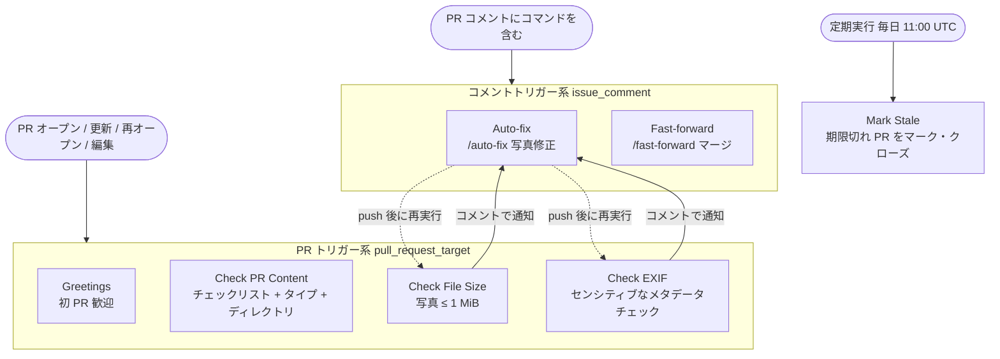
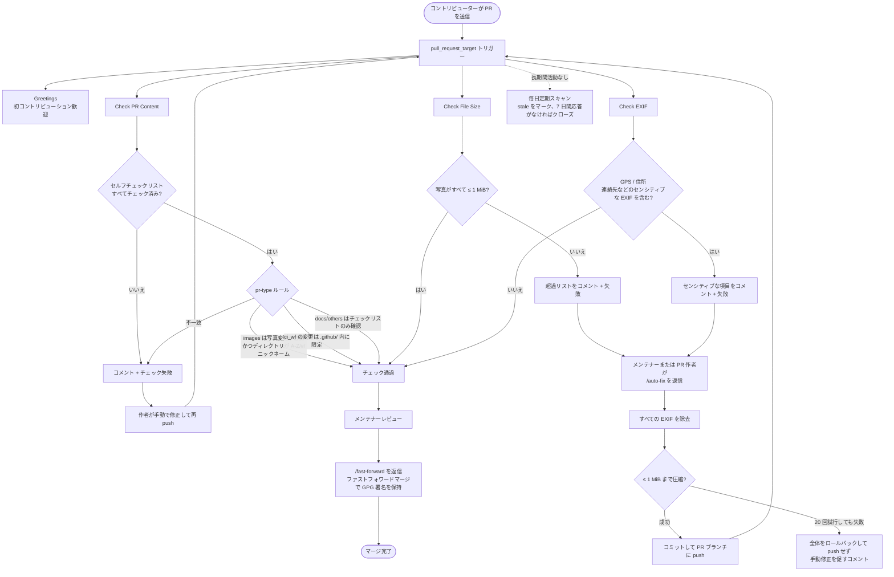

# 🌟 ガイド

Dress プロジェクトへようこそ！このドキュメントに従って、初 PR を作成しましょう。

---

## 📋 提出手順

```
Fork → 写真をアップロード → Commit → PR を作成 → マージされるのを待つこと
```

---

## ステップ1：Fork する

> **Fork** というのは 他人のリポジトリを自分の GitHub アカウントに「丸ごとコピー」して、自由に変更できるようにするものですよ。元のプロジェクトには影響しないにゃん！

1. まずは [Dress](https://github.com/Cute-Dress/Dress) を開いて
2. ページの右上にある **Fork** ボタンをクリックして
3. これで自分のフォークができたにゃん！

---

## ステップ2：写真をアップロードする

> **Commit** というのは ファイルの変更をひとまとまりの履歴として保存する操作ですよ。


### 方法 A：GitHub の Web ページから直接アップロードする（おすすめ！）

1. Fork したリポジトリのページ（`https://github.com/<ユーザー名>/Dress`）を開く
2. 使用予定の個人フォルダ名の頭文字に対応するディレクトリを選ぶ（例：`Nano` なら `N`、数字や記号で始まる場合は `#`）
3. **Add file** → **Create new file** をクリック
4. ファイル名欄に `フォルダ名/README.md`（例：`Nano/README.md`）と入力すると、フォルダが自動で作成される。フォルダ名は GitHub ID と一致している必要はない
5. ファイルに自己紹介など、好きな内容を書く
6. **Commit changes** をクリック
7. もう一度 **Add file** → **Upload files** をクリックして、作成したフォルダに写真をアップロード
8. **Commit changes** をクリック

---

### 方法 B：Git コマンドラインを使う

> **Clone** というのは リモートリポジトリをローカル PC にダウンロードすることです。  
> **Push** というのは ローカルの Commit をリモートリポジトリ（自分の Fork）にアップロードして同期することです。

```bash
# 1. Fork したリポジトリをクローン
# リポジトリのコミット履歴が多いため、--depth 1 で最新のコミットのみ取得できます
git clone --depth 1 https://github.com/<ユーザー名>/Dress.git
cd Dress
```

写真が多くて通常のクローンが遅い場合は、部分クローンで自分のディレクトリだけをダウンロードできます：

```bash
git clone --filter=blob:none --sparse --depth 1 https://github.com/<ユーザー名>/Dress.git
cd Dress
git sparse-checkout set '<頭文字>/<フォルダ名>'
```

部分クローンは通常のコミットや PR に影響しません。ディレクトリ管理、完全な履歴、リポジトリ全体の復元方法については [部分クローンガイド](PARTIAL_CLONE.md) を読んでくださいね。

クローン後、自分のフォルダを作成して写真を追加します：

```bash
# 2. 自分のフォルダを作成して写真を追加
# <頭文字> は <フォルダ名> の先頭文字に対応する。数字や記号で始まる場合は # を使用
mkdir -p <頭文字>/<フォルダ名>
cp /path/to/your/photos/* <頭文字>/<フォルダ名>/

# 3. 変更をコミット
git add .
git commit -m "Add photos for <フォルダ名>"

# 4. Fork に push
git push origin main
```

---

## ステップ3：Pull Request を作成する

> **Pull Request（PR）** というのは 元のリポジトリのメンテナーに「自分の Fork で変更しました。元のプロジェクトにマージしてくださいにゃん！」と申請することですよ。

1. Fork したリポジトリのページに戻る
2. **"This branch is X commits ahead"** という表示が出るので、**Contribute** → **Open pull request** をクリック
3. デフォルトで **写真提出** テンプレートになっている。CI / ドキュメント / その他の変更の場合は、テンプレート下部のリンクから切り替える
4. テンプレート内のセルフチェック項目を**すべて**チェックする。テンプレート上部の `pr-type` マークとチェックリストは削除しないでください
5. **Create pull request** をクリック

---

## ステップ4：レビューを待つ

PR を送信すると、自動で以下がチェックされます：
- 📋 PR 内容チェック：セルフチェックリストが揃っていてすべてチェック済みか、写真変更が含まれているか、ファイルが対応する A-Z/#/ニックネーム/ ディレクトリにあるか
- 📏 ファイルサイズチェック：写真が 1MB 以内か
- 🔒 EXIF 情報チェック：写真にセンシティブなメタデータ（主に GPS 座標 や住所系フィールド）が含まれていないか

> EXIF チェックはセンシティブなフィールド（GPS 座標、IPTC/XMP の住所情報など）のみをブロックします。通常の撮影パラメータ（絞り、シャッタースピードなど）ではチェックは失敗しません。
> 詳しくは [EXIF.md](EXIF.md) に書いてあります。

チェックに通らない場合、PR に理由を説明するコメントが残されます。案内に従って修正して push するか、チェックリストをチェックして PR の説明を保存すると、チェックが自動で再実行されます。

サイズや EXIF が通らない場合、PR 作者またはメンテナーがコメント欄で `/auto-fix` を送信すると自動処理を試みます。このコマンドは写真を 1MB 以内に圧縮し、**すべて**の EXIF を削除します（チェックより徹底的）。ファイルを変更されたくない場合は、自分で処理してから push してください。

メンテナーのレビューが通ると、PR はマージされます。これで初のコントリビューションが完了です。めでたし～めでたし～🎉

---

## ⚠️ 提出前の注意

1. **写真を圧縮すること** — 各写真を 1MB 以内にしてください。[TinyPNG](https://tinypng.com/) などのオンラインツールで圧縮できます。
2. **センシティブな EXIF 情報を削除すること** — 最も重要なのは **GPS 座標**の削除です。撮影場所が正確に分かってしまいます。写真には住所や連絡先などの情報が含まれることもあります。詳しくは [EXIF](EXIF.md) と [コントリビューションの準備](CONTRIBUTING.md) での削除方法をご覧ください。
3. **フォルダ名を正しく付けること** — 意味のあるフォルダ名（GitHub ID と一致している必要はない）を使い、先頭文字に対応する A-Z/# ディレクトリに置いてください。
4. **オリジナル写真だけアップロードすること** — 自分の写真だけを提出してください。盗用写真は受け付けません。
5. **自分のフォルダだけを変更すること** — 他人のフォルダや他のプロジェクトファイルは変更しないでください。メンテナーに不要な手間をかけないようにしましょう。
6. **ファイル名には漢字、仮名、スペースを使わないこと** — ファイル名に漢字、仮名やスペースがあると、一部のシステムで正しく表示・ダウンロードできない場合があります。英数字とハイフンだけを使ってください。

---

## 🔗 参考リンク

- [プロジェクト説明](README.md)
- [コントリビューションの準備](CONTRIBUTING.md)
- [EXIF](EXIF.md)
- [Q&A](Q&A.md)
- [マージ済み PR の参考](https://github.com/Cute-Dress/Dress/pulls?q=is%3Apr+is%3Amerged)

# リポジトリのワークフロー

## 1. ワークフロー体系の全体像



## 2. 写真 PR の完全なライフサイクル


## 3. ワークフロー一覧

| ワークフロー | ファイル | トリガー方式 | 動作 | 権限 |
| --- | --- | --- | --- | --- |
| Greetings | `greetings.yml` | `pull_request_target` | 初めて PR を出す方に歓迎コメント | `issues / pull-requests: write` |
| Check PR Content | `check_pr_content.yml` | `pull_request_target (opened / synchronize / reopened / edited)` | すべてのタイプの PR でセルフチェックリストのチェックが必須。`images` は写真変更があり、ディレクトリが `A-Z/#/ニックネーム/` 構造に従うこと。`ci_wf` の変更はすべて `.github/` 内であること。未知の `pr-type` はエラー | `contents: read, issues / pull-requests: write` |
| Check File Size | `check_file_size.yml` | `pull_request_target (opened / synchronize / reopened)` | `images` タイプの PR のみ：変更写真がすべて ≤ 1 MiB であること。超過時はファイルをコメントで列挙し `/auto-fix` を案内、チェック失敗 | `contents: read, issues / pull-requests: write` |
| Check Image EXIF Data | `check_exif.yml` | `pull_request_target (opened / synchronize / reopened, 同一 PR の同時実行はキャンセル)` | `images` タイプの PR のみ：変更写真をダウンロードし、`exiftool` で GPS・住所・連絡先などのセンシティブな EXIF をチェック。通常の撮影パラメータはブロックしない。該当時はコメントして `/auto-fix` を案内 | `contents: read, issues / pull-requests: write` |
| Auto-fix Image Files | `auto_fix.yml` | `issue_comment`（コメントが `/auto-fix` で始まり、メンテナーまたは PR 作者） | PR ブランチをチェックアウト → `exiftool` で全 EXIF を削除 → ループ圧縮（`jpegoptim / pngquant / optipng / ImageMagick`、最大 20 回）で ≤ 1 MiB まで → PR ブランチに push してチェック再実行。圧縮失敗時は全体をロールバックして push せず、コメントで説明 | `contents / pull-requests / issues: write` |
| Fast-forward for PR | `fast-forward.yml` | `issue_comment / pull_request_review_comment`（コメントに `/fast-forward` を含む） | コメント者の `write` 権限を検証後、ファストフォワードマージを実行（GitHub のマージで GPG 署名が上書きされるのを回避）。`.github/workflows/` を変更した PR のマージには `FAST_FORWARD_TOKEN` が必要 | `contents / pull-requests: write` |
| Mark Stale Issues and PRs | `stale.yml` | `schedule (cron: 00 11 * * *)` | PR のみ対象：長期間活動がない場合に `no-pr-activity` をマークし 7 日以内の応答を促し、応答がなければクローズ（issue は対象外） | `issues / pull-requests: write` |


*説明：`pr-type` は PR 本文中の `<!-- pr-type: xxx -->` タグで識別し、値は `images / ci_wf / docs / others`。省略時は `images` として扱います。*
